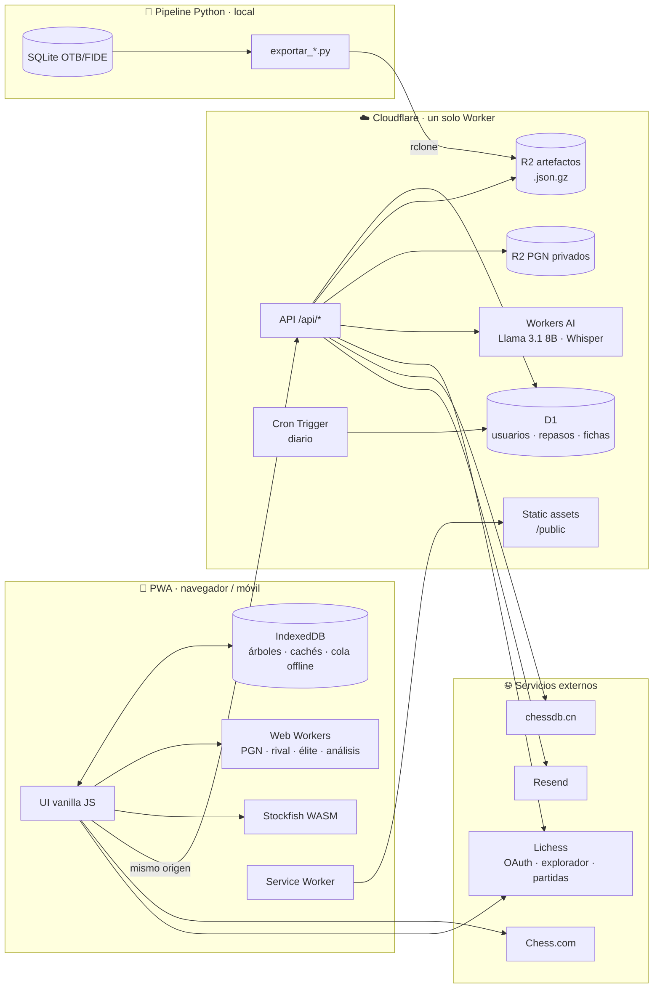

<div align="center">


# OpeningChessAI

**Preparación de aperturas de ajedrez con datos, en el móvil.**<br>
PWA que cruza tu repertorio con las partidas de tus rivales, de los maestros y de la élite FIDE.

<a href="https://app.openingchessai.com"></a>

<br>


<br><br>


</div>

> **EN —** OpeningChessAI is a chess-opening preparation PWA running entirely on Cloudflare's edge
> (Workers + D1 + R2 + Workers AI). It parses your PGN courses into a repertoire tree, mirror-matches it
> against an opponent's games (Lichess, Chess.com or FIDE over-the-board), shows what masters and 2500+
> players play, and drills the result with spaced repetition. **It can be used entirely by voice**: moves and
> piece positions are read aloud and you answer by speaking, for blindfold training and for **accessibility for
> visually impaired players**. A small LLM only parses intent; all numbers are computed on-device from real games.
> Offline-first, vanilla JS, no frameworks. Closed beta with real users.
>
> *This is the public showcase copy of the project. The deployment repository is private.*

---

## 🔊 Se puede usar entero por voz: entrenamiento a ciegas y accesibilidad

OpeningChessAI **habla y escucha**. No es un extra, es una forma completa de usar la app sin mirar la pantalla:

- **La app habla:** con `speechSynthesis` del propio móvil (gratis y sin red) lee las jugadas **como se dicen en un club** («caballo efe seis», «e toma en de cinco», «enroque corto»), no letra a letra, y te dice **dónde está cada pieza** cuando lo pides.
- **La app escucha:** respondes diciendo la jugada. Usa el reconocimiento de voz del navegador y, si no lo hay (Firefox, o el iPhone con la app instalada), **Whisper** (`whisper-large-v3-turbo`) en Workers AI, con detector de silencio para no enviar audio vacío.
- **Nunca una jugada imposible:** lo que se oye se traduce a pieza + casilla y se filtra entre las jugadas **legales** de la posición, así que tolera «caballo F3», «caballo efe tres» o «C f 3».
- **Manos libres de verdad:** habla y después escucha (el micro no se oye a sí mismo), mantiene la pantalla despierta, bloquea los toques accidentales y se calla al salir de la app.

**Para qué sirve:**

- 🙈 **Entrenamiento a ciegas:** repasar tus aperturas de memoria, sin tablero, como en una partida a la ciega, en el modo *Blind*.
- ♿ **Accesibilidad:** las personas con **problemas de visión** pueden repasar su repertorio y entrenar sus líneas solo con la voz.

---

## 🎬 Demo

https://github.com/user-attachments/assets/d1347f30-8ae1-483b-b8ce-789cd3aa2e48

<p align="center"><a href="https://app.openingchessai.com"><b>app.openingchessai.com</b></a> · acceso con aprobación manual</p>

---

## ✨ Qué hace

| | Función | En una frase |
|---|---|---|
| 📚 | **Cursos PGN** | Sube tus PGN de repertorio: un parser propio lee el movetext entero (variantes anidadas, comentarios, NAGs) y fusiona las partidas en un árbol navegable. |
| 🗂️ | **Repertorio** | Cursos marcados como repertorio + líneas sueltas a mano, con el nombre de la apertura detectado en cada posición. |
| 🕵️ | **Análisis de rival con cruce en espejo** | Descarga las partidas del rival (Lichess, Chess.com o torneos FIDE), las cruza posición a posición contra tu repertorio y te enseña **sus huecos y los tuyos**, por familia de apertura, con el «libro del rival». |
| 🏛️ | **Explorador de maestros** | Base de maestros de Lichess navegable con partidas modelo, evaluación en la nube y Stockfish en el propio móvil. |
| 👑 | **Partidas de élite (2500+)** | Qué partidas de jugadores 2500+ pasan por tus líneas y **hasta qué jugada** te siguen, exportables a PGN. |
| 📈 | **Análisis de tus partidas** | Tus partidas de Lichess, Chess.com, FIDE o PGN: dónde te sales tú de la teoría, dónde te sacan, precisión por fase con motor y fichas de tus errores. |
| 🧠 | **Entrenador + flashcards** | Juega tus líneas contra un rival que responde **por frecuencia**; las posiciones falladas pasan a fichas con repetición espaciada (FSRS simplificado). Funciona sin cobertura. |
| 🙈 | **Blind (a ciegas) y voz** | Repaso a ciegas de cursos y fichas, modo Easy/Hard y **manos libres por voz**: la app recita jugadas y posiciones, y tú respondes hablando. También pensado para **accesibilidad**. |
| 🏆 | **Progreso** | Experiencia, rangos globales y por curso, racha y objetivos diarios/semanales. |
| 🤖 | **Asistente IA** | Pregunta en lenguaje natural («juego de negras contra X, ¿qué juega de blancas?»), escrito o hablado. |
| 💡 | **Sugerencia diaria** | Cada día un **hueco** (lo que los maestros juegan y tu repertorio no cubre) o una **sorpresa** (jugada poco frecuente con buen resultado). |
| 🔐 | **Beta cerrada** | Acceso con Lichess (OAuth PKCE) o enlace mágico por correo; las cuentas nuevas esperan aprobación manual. |

> La app está en **beta cerrada** y ya la usan **usuarios reales**.

### 🤖 El asistente, en detalle

- **El modelo solo entiende, no responde.** `/api/chat` envía la frase a **Llama 3.1 8B** (Workers AI) en modo JSON con un esquema cerrado y devuelve una *intención*: acción, rival, color, jugadas.
- **Las cifras las calcula el móvil** sobre partidas reales (`public/chat.js`): el modelo no escribe ni un porcentaje, así que no puede alucinarlos.
- **Las variantes por nombre** («francesa Tarrasch») se resuelven contra 3.865 líneas de `lichess-org/chess-openings`, todas validadas con chess.js.
- **Degradación elegante:** sin red, sin cupo o si el modelo falla, un intérprete de reglas local entiende las frases habituales.
- **Voz:** reconocimiento del navegador y, si no hay, **Whisper** (`whisper-large-v3-turbo`) en Workers AI, con detector de silencio. De la voz a la jugada se filtra siempre entre jugadas **legales**.
- **Cupos por usuario y globales** para no salir del plan gratuito de Workers AI.

### 🎙️ Cómo funciona el asistente por voz (y dónde entra Whisper)

El asistente se abre desde el botón flotante con el icono de la app. Se le puede escribir o tocar el micro y preguntar hablando:

1. **Voz → texto.** Primero se usa el reconocimiento de voz del navegador (`SpeechRecognition`, en Chrome y Safari), que es instantáneo y gratis. Si no existe o el sistema lo bloquea (Firefox, o un iPhone con la app instalada), `public/voz.js` graba la frase en el móvil (WAV mono de 16 kHz, cortando al callarte y sin enviar nada si no hubo voz) y la manda a `/api/voz`. Ahí el Worker la transcribe con **Whisper** (`@cf/openai/whisper-large-v3-turbo`) en Workers AI, en castellano, con filtro VAD y un *prompt* con vocabulario de ajedrez («caballo f3», «enroque corto», «Caro-Kann»…).
2. **Texto → intención.** `/api/chat` pasa la pregunta a **Llama 3.1 8B** (`@cf/meta/llama-3.1-8b-instruct`) en modo JSON con un esquema cerrado. El modelo **no responde**: solo devuelve qué quieres (jugadas del rival, resumen, huecos, abrir Rival, ayuda o ir a una pestaña), además del rival, el color y las jugadas.
3. **Intención → respuesta con datos reales.** `public/chat.js` monta la respuesta en el móvil con el análisis guardado de Rival, los datos FIDE y las partidas de Lichess y Chess.com. Las dudas sobre la app se responden con el índice de ayuda (`datos/ayuda.json`) y la guía de aperturas. Las cifras se cuentan, nunca las inventa el modelo.
4. **Respuesta → voz.** Si la pregunta llegó por voz, la respuesta se lee en alto con `speechSynthesis` del propio móvil, que prefiere una voz en castellano de España.

Si no hay red, se acaba el cupo o el modelo falla, un intérprete de reglas local (`interpretarLocal()`) entiende las frases habituales. Cada usuario tiene cupos diarios (60 mensajes de chat y 150 frases de voz) para no salir del plan gratuito de Workers AI.

---

## 🏗️ Arquitectura



**Un solo Worker** sirve la PWA (static assets) y la API: mismo origen, sin CORS ni preflights, y la cookie de sesión viaja sola. El Worker no tiene dependencias en tiempo de ejecución.

---

## 🧰 Stack

| Capa | Tecnología |
|---|---|
| **Frontend** | HTML + CSS + JavaScript vanilla (sin frameworks ni CDN), PWA instalable con Service Worker |
| **Cálculo en cliente** | Web Workers, `chess.js` 1.4.0 (vendorizado), Stockfish 19 lite (WASM, single-thread) |
| **Almacenamiento local** | IndexedDB (árboles de cursos, análisis guardados, cola de repasos offline) |
| **Backend** | Cloudflare Workers (static assets + API en el mismo Worker) |
| **Base de datos** | Cloudflare D1 (SQLite), esquema idempotente + migraciones |
| **Objetos** | Cloudflare R2: un bucket de artefactos precalculados y otro de PGN privados |
| **IA** | Workers AI: `llama-3.1-8b-instruct` (intención en JSON) y `whisper-large-v3-turbo` (voz) |
| **Tareas programadas** | Cron Trigger diario |
| **Autenticación** | Lichess OAuth2 con PKCE, enlace mágico de un solo uso por correo (Resend), sesión firmada con HMAC-SHA256 |
| **Datos externos** | Lichess (explorador de maestros, partidas), Chess.com, chessdb.cn (evaluación), `lichess-org/chess-openings` |
| **Pipeline de datos** | Python 3.12 + SQLite → artefactos `.json.gz` → R2 (rclone) |
| **CI/CD** | Workers Builds: cada `git push` a `main` despliega |
| **Observabilidad** | Workers Observability, `/api/health` y página de diagnóstico `/estado.html` |

---

## 🗄️ Datos

La parte de *data engineering* vive en `herramientas/`. Se ejecuta **en local**: la app nunca consulta las bases originales, solo lee artefactos ya preparados en R2.

```
SQLite OTB/FIDE (local)  ──►  exportar_*.py  ──►  .json.gz troceados  ──►  R2  ──►  /api/art/* (con sesión, caché de edge)  ──►  móvil
```

| Script | Qué produce |
|---|---|
| `exportar_rivales.py` | Partidas de torneo agrupadas en **2.048 cubos** por `fide_id % 2048` + índice de nombres para el buscador. Lee varias bases, deduplica y descarta Freestyle/960. |
| `exportar_censo.py` | El **censo FIDE completo** (≈1,8 M de fichas sin partidas), troceado por las tres primeras letras del nombre para que buscar no descargue megas. |
| `exportar_probables.py` | Partidas **sin ID FIDE** atribuidas por nombre con tres «candados» (nombre idéntico, candidato único, Elo coherente), marcadas como «por nombre». |
| `exportar_elite.py` | Partidas con **los dos jugadores 2500+**, completas, en un fichero por bloque de apertura (tope por bloque, las de más Elo primero). |
| `bloques.py` | Tabla de rangos ECO → familia de apertura, gemela de `public/bloques.js`. |
| `aperturas_guia.mjs` | Genera y **verifica con chess.js** la guía de aperturas del asistente. |

Cifras del volcado actual: **78.593 jugadores** con partidas, **3.091.517 filas** de partida (cada partida va en los dos jugadores) y **1.817.994** fichas de censo sin partidas. Al limpiar la base salió que **una de cada tres partidas era una copia**.

Los artefactos llevan un `meta.json` con su fecha: la app lo compara con lo que tiene guardado y **solo vuelve a descargar lo que ha cambiado**.

---

## 🧩 Decisiones técnicas

- **Worker con static assets en vez de Pages.** Pages Functions no soporta Cron Triggers. El router mantiene la firma `onRequest(context)` de Pages, así que la migración no tocó la lógica.
- **`not_found_handling = "none"` y `html_handling = "none"`.** Con el modo SPA el asset server devolvería `index.html` también para `/api/*` y la API desaparecería. Además, una ruta como `/rival/magnus` debe llegar al Worker y servir `index.html` **conservando la URL**. El fallback de SPA lo hace el propio Worker.
- **Todo lo pesado, fuera del hilo principal.** Parsear un PGN, cruzar 400 partidas × 20 jugadas o recorrer la base de élite son miles de posiciones. Se hace en Web Workers para que la interfaz no se congele.
- **El edge sirve bytes y el móvil calcula.** Los cruces se hacen en el dispositivo, con los árboles que ya están en IndexedDB. Por eso la **sugerencia diaria se calcula en el móvil** (subir el repertorio a D1 sería mover datos privados para nada) y el cron diario se queda con la limpieza del servidor.
- **Cruzar por posición, no por camino.** Se mete el repertorio en un conjunto de posiciones y cada partida se reproduce **una sola vez**: las transposiciones salen gratis. Además se ordena por **profundidad** de coincidencia, no por un sí/no.
- **Cubos y no un fichero por jugador.** Un fichero por jugador serían casi 50.000 objetos. 2.048 cubos se suben y sincronizan en incremental y pesan poco para un móvil, sobre todo con caché de edge.
- **Log append-only como fuente de verdad.** `review_events` lleva el instante del repaso en la clave primaria. Reenviar un lote tras un corte de red no duplica nada, dos móviles no entran en conflicto, y el estado FSRS y la experiencia son **derivados y reconstruibles**.
- **Offline-first.** Las últimas respuestas de sesión, repertorio y cursos se guardan en IndexedDB (que se puede leer desde el código, al contrario que la caché del Service Worker). Los repasos se encolan y se suben al volver la red.
- **Proxies con caché donde tiene sentido.** El explorador de Lichess (que exige token desde 2026) y chessdb.cn (sin CORS) pasan por el Worker y se cachean en el edge: dos usuarios mirando la misma Najdorf generan una sola petición.
- **IA acotada.** El LLM solo clasifica la intención en un JSON con esquema. Los campos que se inventa se descartan y los números salen siempre de los datos.
- **Seguridad sin librerías.** Token propio con payload + HMAC (sin JWT ni algoritmo `none` que desactivar), enlaces mágicos de un solo uso, PKCE sin `client_secret`, buckets R2 **no públicos** y cuotas de correo con `UPSERT` atómico.
- **Puerta cerrada con 403, no 401.** «Sé quién eres y aún no puedes entrar» no debe mandar al login en bucle.

---

## 🛠️ Desarrollo y despliegue

```bash
npm install
npm run db:local     # crea las tablas en la D1 local
npm run dev          # http://localhost:8787
npm run deploy       # o simplemente git push: Workers Builds despliega main
```

Antes del primer despliegue crea tu propia D1 (`npx wrangler d1 create <nombre>`) y pon su id en `database_id` de `wrangler.toml` (en este repo aparece como `PON_AQUI_EL_ID`). Cambia también la ruta `app.openingchessai.com` por tu dominio.

Al cambiar el esquema, aplica también las migraciones de `migraciones/` en orden:

```bash
npx wrangler d1 execute xaketegi --file=migraciones/00N_....sql --remote
```

**Secretos** (nunca en el repo, con `npx wrangler secret put <NOMBRE>`; para local, copia `.dev.vars.example` a `.dev.vars`): `SESSION_SECRET`, `RESEND_KEY`, `LICHESS_CLIENT_ID`, `ADMIN` (sin él nadie puede aprobar accesos) y, opcionalmente, `LICHESS_EXPLORER_TOKEN`.

> ℹ️ Este repositorio es la **copia pública de escaparate** del proyecto. El repositorio de despliegue (con la documentación interna de cada fase) es privado. Las bases SQLite de origen del pipeline no se incluyen.

<details>
<summary><b>📁 Estructura del repositorio</b></summary>

```
src/index.js        entrada del Worker: /api/* o ficheros estáticos
src/api.js          router de la API
src/cron.js         tarea diaria
public/             la PWA: index.html, app.css, módulos JS y Web Workers (worker-*.js)
public/datos/       aperturas, guía del asistente y ayuda
public/vendor/      chess.js 1.4.0 y Stockfish 19 lite (WASM)
schema.sql          esquema de D1
migraciones/        cambios de esquema posteriores, en orden
herramientas/       pipeline Python de datos → R2
.dev.vars.example   nombres de los secretos (sin valores)
LICENSE             todos los derechos reservados (código propio)
```

</details>

---

## 📜 Licencia

**Licencia:** © 2026 Eneko Ostolozaga, todos los derechos reservados. El código se publica solo para consulta como portfolio: no se permite copiarlo, modificarlo, redistribuirlo ni usarlo sin permiso previo por escrito. Detalles en [`LICENSE`](LICENSE).

- Los componentes de terceros **conservan sus licencias** y quedan fuera de esa reserva:
  - **Stockfish.js 19 lite** (WASM), **GPLv3**: [`public/vendor/stockfish/`](public/vendor/stockfish/) con el texto completo en [`COPYING`](public/vendor/stockfish/COPYING). Fuente: [nmrugg/stockfish.js](https://github.com/nmrugg/stockfish.js).
  - **chess.js** 1.4.0, **BSD-2-Clause**: [`public/vendor/chess.js.LICENSE`](public/vendor/chess.js.LICENSE).
  - **Piezas *cburnett*** de Colin M. L. Burnett (Wikimedia Commons; GFDL, BSD o GPL), el mismo juego que usa Lichess.
  - **Nombres de apertura y ECO:** [`lichess-org/chess-openings`](https://github.com/lichess-org/chess-openings), dominio público (**CC0**): [`public/datos/aperturas.LICENSE`](public/datos/aperturas.LICENSE).

---

## 👤 Autor

<div align="center">

**Eneko Ostolozaga**: Data Science & IA

<a href="https://github.com/Eostolozaga"></a>
<a href="https://www.linkedin.com/in/eneko-ostolozaga-data-science"></a>

</div>
