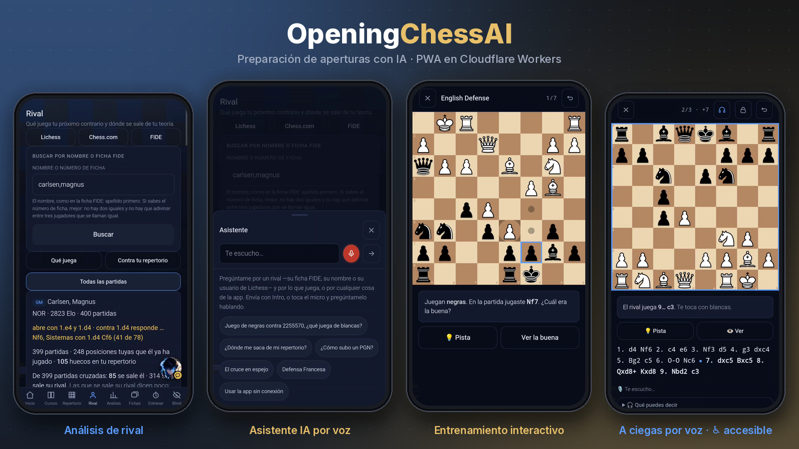
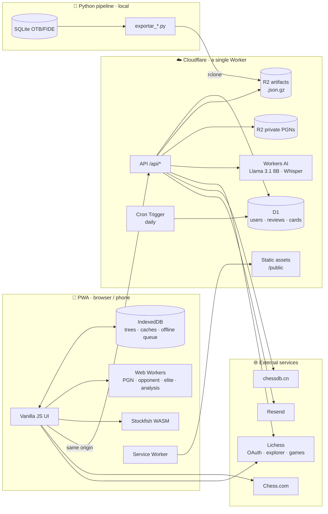

<div align="center">


# OpeningChessAI

**Chess opening preparation from real games, on your phone.**<br>
A PWA that matches your repertoire against your opponents' games, master games, and FIDE elite games.

<a href="https://app.openingchessai.com"></a>

<br>


<br><br>



</div>

OpeningChessAI is a chess-opening preparation PWA that runs entirely on Cloudflare's edge (Workers + D1 + R2 + Workers AI). It parses your PGN courses into a repertoire tree, mirror-matches that tree against an opponent's games (Lichess, Chess.com, or FIDE over-the-board), shows what masters and 2500+ players play, and drills the result with spaced repetition. **It can be used entirely by voice**: moves and piece positions are read aloud and you answer by speaking, for blindfold training and for **accessibility for visually impaired players**. A small LLM only parses intent; every figure is computed on the device from real games. Offline-first, vanilla JavaScript, no frameworks. Closed beta with real users.

> **The app interface is currently in Spanish.** Voice mode speaks and recognises Spanish chess notation (for example, «caballo efe seis»). This repository's documentation is in English; the in-app copy and speech logic are not.

*This is the public showcase copy of the project. The deployment repository is private.*

---

## 🔊 The whole app can be used by voice: blindfold training and accessibility

OpeningChessAI **speaks and listens**. Voice is not an add-on. It is a complete way to use the app without looking at the screen:

- **The app speaks:** using the phone's own `speechSynthesis` (free, and no network required) it reads moves **the way they are said in a club** («caballo efe seis», «e toma en de cinco», «enroque corto»), not letter by letter, and it tells you **where each piece is** when you ask.
- **The app listens:** you answer by saying the move. It uses the browser's speech recognition and, when that is unavailable (Firefox, or an iPhone with the app installed), **Whisper** (`whisper-large-v3-turbo`) on Workers AI, with a silence detector so empty audio is never uploaded.
- **Never an illegal move:** what is heard is turned into a piece plus a square and then filtered to the **legal** moves in the position, so it tolerates «caballo F3», «caballo efe tres», or «C f 3».
- **Truly hands-free:** it speaks and then listens (the microphone does not hear itself), keeps the screen awake, blocks accidental taps, and goes quiet when you leave the app.

**What it is for:**

- 🙈 **Blindfold training:** review your openings from memory, without a board, as in a blindfold game, in *Blind* mode.
- ♿ **Accessibility:** players with **visual impairments** can review their repertoire and train their lines by voice alone.

---

## 🎬 Demo

https://github.com/user-attachments/assets/d1347f30-8ae1-483b-b8ce-789cd3aa2e48

<p align="center"><a href="https://app.openingchessai.com"><b>app.openingchessai.com</b></a> · access by manual approval</p>

---

## ✨ What it does

| | Feature | In one sentence |
|---|---|---|
| 📚 | **PGN courses** | Upload your repertoire PGNs: a custom parser reads the full movetext (nested variations, comments, NAGs) and merges the games into a navigable tree. |
| 🗂️ | **Repertoire** | Courses marked as repertoire, plus one-off lines entered by hand, with the opening name detected at each position. |
| 🕵️ | **Opponent analysis with mirror matching** | Downloads the opponent's games (Lichess, Chess.com, or FIDE tournaments), crosses them position by position with your repertoire, and shows **their gaps and yours**, by opening family, with the opponent's "book". |
| 🏛️ | **Master explorer** | A browsable Lichess masters database with model games, cloud evaluation, and Stockfish on the phone itself. |
| 👑 | **Elite games (2500+)** | Which games by 2500+ players pass through your lines, and **how far** they follow you, exportable to PGN. |
| 📈 | **Analysis of your games** | Your games from Lichess, Chess.com, FIDE, or PGN: where you leave theory, where you are taken out of it, engine accuracy by phase, and cards for your mistakes. |
| 🧠 | **Trainer + flashcards** | Play your lines against an opponent that answers **by frequency**; missed positions become cards with spaced repetition (simplified FSRS). Works offline. |
| 🙈 | **Blind (blindfold) and voice** | Blindfold review of courses and cards, Easy/Hard mode, and **hands-free voice**: the app recites moves and positions, and you answer by speaking. Also built for **accessibility**. |
| 🏆 | **Progress** | Experience, global and per-course ranks, streak, and daily/weekly goals. |
| 🤖 | **AI assistant** | Ask in natural language («juego de negras contra X, ¿qué juega de blancas?»), typed or spoken. |
| 💡 | **Daily suggestion** | Each day, a **gap** (what masters play that your repertoire does not cover) or a **surprise** (an uncommon move with a good score). |
| 🔐 | **Closed beta** | Sign in with Lichess (OAuth PKCE) or a magic email link; new accounts wait for manual approval. |

> The app is in **closed beta** and is already used by **real users**.

### 🤖 The assistant, in detail

- **The model only understands; it does not answer.** `/api/chat` sends the sentence to **Llama 3.1 8B** (Workers AI) in JSON mode with a closed schema and gets back an *intent*: action, opponent, colour, moves.
- **The figures are computed on the phone** from real games (`public/chat.js`): the model never writes a percentage, so it cannot hallucinate one.
- **Named variations** («francesa Tarrasch») are resolved against 3,865 lines from `lichess-org/chess-openings`, all validated with chess.js.
- **Graceful degradation:** with no network, no quota, or a model failure, a local rule interpreter handles the usual phrases.
- **Voice:** browser speech recognition and, if that is missing, **Whisper** (`whisper-large-v3-turbo`) on Workers AI, with a silence detector. From speech to a move, the result is always filtered to **legal** moves.
- **Per-user and global quotas** so the app stays inside the Workers AI free plan.

### 🎙️ How the voice assistant works (and where Whisper fits)

The assistant opens from the floating button with the app icon. You can type, or tap the microphone and ask out loud:

1. **Speech → text.** The browser's speech recognition (`SpeechRecognition`, in Chrome and Safari) is tried first. It is instant and free. If it does not exist or the system blocks it (Firefox, or an iPhone with the app installed), `public/voz.js` records the phrase on the phone (16 kHz mono WAV, cutting when you stop talking and sending nothing if there was no speech) and posts it to `/api/voz`. The Worker transcribes it with **Whisper** (`@cf/openai/whisper-large-v3-turbo`) on Workers AI, in Spanish, with a VAD filter and a prompt of chess vocabulary («caballo f3», «enroque corto», «Caro-Kann»…).
2. **Text → intent.** `/api/chat` passes the question to **Llama 3.1 8B** (`@cf/meta/llama-3.1-8b-instruct`) in JSON mode with a closed schema. The model **does not answer**: it only returns what you want (the opponent's moves, a summary, gaps, open Rival, help, or go to a tab), plus the opponent, the colour, and the moves.
3. **Intent → an answer from real data.** `public/chat.js` builds the reply on the phone from the saved Rival analysis, FIDE data, and Lichess and Chess.com games. Questions about the app are answered from the help index (`datos/ayuda.json`) and the openings guide. Figures are counted; the model never invents them.
4. **Answer → speech.** If the question arrived by voice, the reply is read aloud with the phone's own `speechSynthesis`, which prefers a voice from Spain.

If there is no network, the quota runs out, or the model fails, a local rule interpreter (`interpretarLocal()`) understands the usual phrases. Each user has daily quotas (60 chat messages and 150 voice phrases) so the app stays inside the Workers AI free plan.

---

## 🏗️ Architecture



**A single Worker** serves the PWA (static assets) and the API: same origin, no CORS and no preflights, and the session cookie travels on its own. The Worker has no runtime dependencies.

---

## 🧰 Stack

| Layer | Technology |
|---|---|
| **Frontend** | HTML + CSS + vanilla JavaScript (no frameworks, no CDN), installable PWA with a Service Worker |
| **Client-side compute** | Web Workers, `chess.js` 1.4.0 (vendored), Stockfish 19 lite (WASM, single-thread) |
| **Local storage** | IndexedDB (course trees, saved analyses, offline review queue) |
| **Backend** | Cloudflare Workers (static assets + API in the same Worker) |
| **Database** | Cloudflare D1 (SQLite), idempotent schema + migrations |
| **Objects** | Cloudflare R2: one bucket of precomputed artifacts and one of private PGNs |
| **AI** | Workers AI: `llama-3.1-8b-instruct` (intent as JSON) and `whisper-large-v3-turbo` (voice) |
| **Scheduled tasks** | Daily Cron Trigger |
| **Authentication** | Lichess OAuth2 with PKCE, one-time magic email link (Resend), session signed with HMAC-SHA256 |
| **External data** | Lichess (masters explorer, games), Chess.com, chessdb.cn (evaluation), `lichess-org/chess-openings` |
| **Data pipeline** | Python 3.12 + SQLite → `.json.gz` artifacts → R2 (rclone) |
| **CI/CD** | Workers Builds: every `git push` to `main` deploys |
| **Observability** | Workers Observability, `/api/health`, and the diagnostic page `/estado.html` |

---

## 🗄️ Data

The data-engineering side lives in `herramientas/`. It runs **locally**: the app never queries the source databases. It only reads artifacts that have already been prepared in R2.

```
SQLite OTB/FIDE (local)  ──►  exportar_*.py  ──►  chunked .json.gz  ──►  R2  ──►  /api/art/* (session required, edge cache)  ──►  phone
```

| Script | What it produces |
|---|---|
| `exportar_rivales.py` | Tournament games grouped into **2,048 buckets** by `fide_id % 2048`, plus a name index for the search box. Reads several databases, deduplicates, and drops Freestyle/960. |
| `exportar_censo.py` | The **full FIDE census** (≈1.8 M records with no games), split by the first three letters of the name so a search does not download megabytes. |
| `exportar_probables.py` | Games **with no FIDE ID**, attributed by name with three locks (identical name, a single candidate, consistent Elo), marked as "by name". |
| `exportar_elite.py` | Games in which **both players are 2500+**, kept in full, one file per opening block (a cap per block, highest Elo first). |
| `bloques.py` | ECO range → opening-family table, the twin of `public/bloques.js`. |
| `aperturas_guia.mjs` | Builds and **verifies with chess.js** the assistant's openings guide. |

Figures from the current dump: **78,593 players** with games, **3,091,517 game rows** (each game is stored under both players), and **1,817,994** census records with no games. Cleaning the database showed that **one game in three was a duplicate**.

Artifacts carry a `meta.json` with their date: the app compares it with what it has stored and **downloads again only what has changed**.

---

## 🧩 Technical decisions

- **A Worker with static assets, rather than Pages.** Pages Functions do not support Cron Triggers. The router keeps the Pages `onRequest(context)` signature, so the migration did not touch the logic.
- **`not_found_handling = "none"` and `html_handling = "none"`.** In SPA mode the asset server would also return `index.html` for `/api/*`, and the API would disappear. A route such as `/rival/magnus` must reach the Worker and serve `index.html` **while keeping the URL**. The Worker itself does the SPA fallback.
- **Everything heavy stays off the main thread.** Parsing a PGN, crossing 400 games × 20 moves, or walking the elite database is thousands of positions. That work runs in Web Workers so the interface does not freeze.
- **The edge serves bytes and the phone computes.** Cross-matches happen on the device, against the trees already in IndexedDB. That is why the **daily suggestion is computed on the phone** (uploading the repertoire to D1 would move private data for no benefit) and the daily cron is left with server cleanup.
- **Match by position, not by path.** The repertoire is placed in a set of positions and each game is replayed **once**: transpositions come for free. Results are also ordered by **depth** of the match, not by a yes/no.
- **Buckets, not one file per player.** One file per player would be almost 50,000 objects. 2,048 buckets upload and sync incrementally, and they are small enough for a phone, especially with an edge cache.
- **An append-only log as the source of truth.** `review_events` puts the review timestamp in the primary key. Resending a batch after a network drop duplicates nothing, two phones do not conflict, and the FSRS state and experience are **derived and rebuildable**.
- **Offline-first.** The latest session, repertoire, and course responses are stored in IndexedDB (which code can read, unlike the Service Worker cache). Reviews are queued and uploaded when the network returns.
- **Cached proxies where they earn their place.** The Lichess explorer (which has required a token since 2026) and chessdb.cn (no CORS) go through the Worker and are cached at the edge: two users looking at the same Najdorf produce a single request.
- **Bounded AI.** The LLM only classifies intent into a JSON object with a schema. Fields it invents are discarded, and numbers always come from the data.
- **Security without libraries.** A custom token of payload + HMAC (no JWT, and no `none` algorithm to disable), one-time magic links, PKCE with no `client_secret`, R2 buckets that are **not public**, and email quotas with an atomic `UPSERT`.
- **A closed door returns 403, not 401.** "I know who you are, and you cannot come in yet" must not send the user into a login loop.

---

## 🛠️ Development and deployment

```bash
npm install
npm run db:local     # creates the tables in local D1
npm run dev          # http://localhost:8787
npm run deploy       # or just git push: Workers Builds deploys main
```

Before the first deploy, create your own D1 database (`npx wrangler d1 create <name>`) and put its id in `database_id` in `wrangler.toml` (in this repo it appears as `PON_AQUI_EL_ID`). Also change the `app.openingchessai.com` route to your domain.

When the schema changes, apply the migrations in `migraciones/` in order as well:

```bash
npx wrangler d1 execute xaketegi --file=migraciones/00N_....sql --remote
```

**Secrets** (never in the repo; set them with `npx wrangler secret put <NAME>`; for local development, copy `.dev.vars.example` to `.dev.vars`): `SESSION_SECRET`, `RESEND_KEY`, `LICHESS_CLIENT_ID`, `ADMIN` (without it, nobody can approve access), and optionally `LICHESS_EXPLORER_TOKEN`.

> ℹ️ This repository is the **public showcase copy** of the project. The deployment repository (with the internal notes for each phase) is private. The pipeline's source SQLite databases are not included.

<details>
<summary><b>📁 Repository layout</b></summary>

```
src/index.js        Worker entry: /api/* or static files
src/api.js          API router
src/cron.js         daily task
public/             the PWA: index.html, app.css, JS modules, and Web Workers (worker-*.js)
public/datos/       openings, the assistant guide, and help
public/vendor/      chess.js 1.4.0 and Stockfish 19 lite (WASM)
schema.sql          D1 schema
migraciones/        later schema changes, in order
herramientas/       Python data pipeline → R2
.dev.vars.example   secret names (no values)
LICENSE             all rights reserved (original code)
```

</details>

---

## 📜 License

**License:** © 2026 Eneko Ostolozaga, all rights reserved. The code is published for viewing as a portfolio only: copying, modifying, redistributing, or using it without prior written permission is not allowed. Details in [`LICENSE`](LICENSE).

- Third-party components **keep their own licenses** and are outside that reservation:
  - **Stockfish.js 19 lite** (WASM), **GPLv3**: [`public/vendor/stockfish/`](public/vendor/stockfish/) with the full text in [`COPYING`](public/vendor/stockfish/COPYING). Source: [nmrugg/stockfish.js](https://github.com/nmrugg/stockfish.js).
  - **chess.js** 1.4.0, **BSD-2-Clause**: [`public/vendor/chess.js.LICENSE`](public/vendor/chess.js.LICENSE).
  - **cburnett pieces** by Colin M. L. Burnett (Wikimedia Commons; GFDL, BSD, or GPL), the same set Lichess uses.
  - **Opening names and ECO codes:** [`lichess-org/chess-openings`](https://github.com/lichess-org/chess-openings), public domain (**CC0**): [`public/datos/aperturas.LICENSE`](public/datos/aperturas.LICENSE).

---

## 👤 Author

<div align="center">

**Eneko Ostolozaga**: Data Science & AI

<a href="https://github.com/Eostolozaga"></a>
<a href="https://www.linkedin.com/in/eneko-ostolozaga-data-science"></a>

</div>
